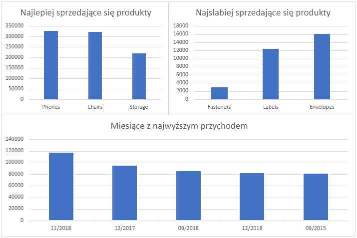

# Analiza Sprzedaży E-commerce (Projekt do Portfolio)

## Źródło Danych
Projekt opiera się na publicznym zbiorze danych pochodzącym z platformy Kaggle:
*[Kaggle - Sales Forecasting Dataset](https://www.kaggle.com/datasets/rohitsahoo/sales-forecasting)*

Oryginalny plik `train.csv` (zawierający tysiące wierszy danych sprzedażowych) został zaimportowany przeze mnie z platformy Kaggle do bazy danych SQLite jako główna tabela o nazwie sales. Na tej tabeli operuje cały kod analityczny w tym projekcie.

## Cel Projektu
Celem analizy było wyciągnięcie kluczowych wskaźników biznesowych dotyczących przychodów (Sales) oraz identyfikacja najlepiej i najgorzej sprzedających się podkategorii produktów, a także zbadanie trendów w czasie.

## Wykorzystane Narzędzia
- **SQL (SQLite / DB Browser)**: Ekstrakcja danych, filtrowanie, agregacja (funkcje `GROUP BY`, `SUM`) oraz manipulacja ciągami znaków (`SUBSTR`) w celu wyciągnięcia trendów miesięcznych.
- **Excel**: Wizualizacja wyników zapytań SQL w formie przejrzystego dashboardu.
- **GitHub**: Dokumentacja projektu i prezentacja w portfolio.

## Dashboard (Wizualizacja)

## Kluczowe Wnioski Biznesowe
1. **Najlepsze produkty**: Największy przychód generują podkategorie: Phones, Chairs oraz Storage.
2. **Najsłabsze produkty**: Najmniejszy przychód przynoszą podkategorie: Fasteners, Labels oraz Envelopes. Należy rozważyć sens ich dalszego magazynowania lub zmienić strategię marketingową.
3. **Okresy szczytowe**: Największe piki sprzedażowe zauważono w miesiącach jesienno-zimowych, co wskazuje na silne trendy sezonowe (np. zakupy świąteczne).

## Struktura Plików w Projekcie
- [Skrypt SQL](./analiza_sprzedazy.sql) – Mój kod SQL użyty do wydobycia powyższych informacji z surowej tabeli.
- `dashboard.png` – Obraz przedstawiający finalne wykresy analityczne.
